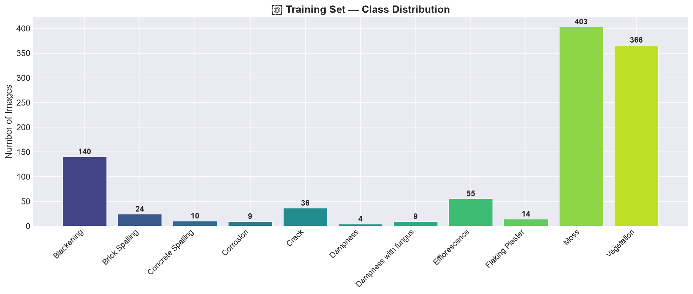
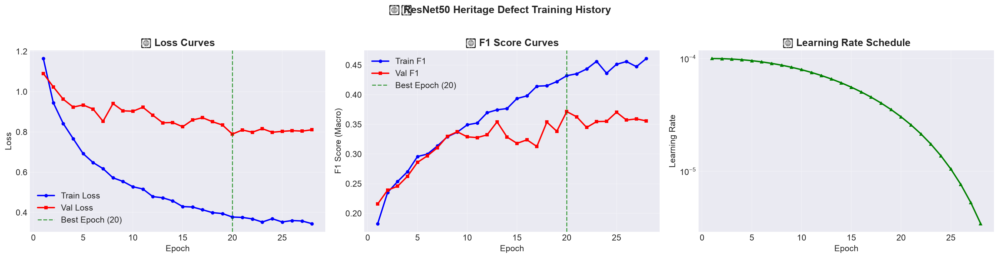
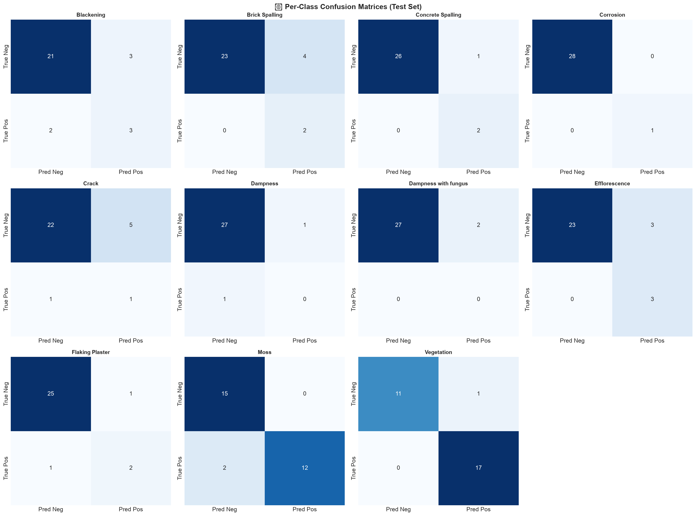
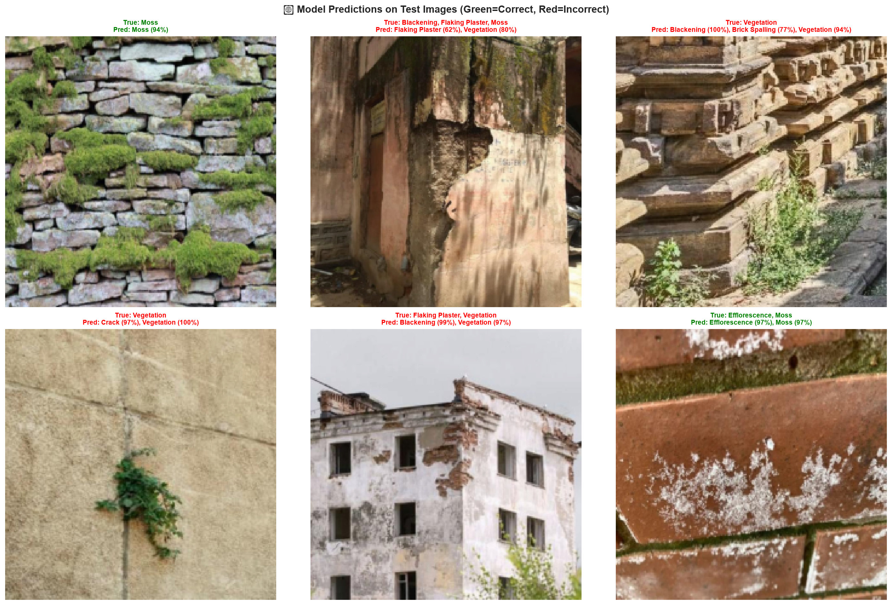

# 🏛️ HeritagePreservation

[](https://www.python.org/)
[](https://pytorch.org/)
[](https://github.com/ultralytics/ultralytics)
[](https://creativecommons.org/licenses/by/4.0/)
[](https://universe.roboflow.com/mossdetectionproject-scxsl/heritagedefect/dataset/2)

Computer vision framework for automated diagnosis, multi-label classification, and instance segmentation of structural and biological defects in cultural heritage monuments, historic masonry, and stone architecture.

---

## 📌 Table of Contents
- [Overview](#-overview)
- [Defect Taxonomy (11 Classes)](#-defect-taxonomy-11-classes)
- [Dataset](#-dataset)
- [Repository Structure](#-repository-structure)
- [Model Approaches](#-model-approaches)
  - [1. ResNet50 Multi-Label Classification](#1-resnet50-multi-label-classification)
  - [2. YOLOv8 Nano Instance Segmentation](#2-yolov8-nano-instance-segmentation)
- [Installation & Environment Setup](#-installation--environment-setup)
- [Usage & Training](#-usage--training)
  - [ResNet50 Pipeline](#resnet50-pipeline)
  - [YOLOv8 Segmentation Pipeline](#yolov8-segmentation-pipeline)
- [Results & Evaluation](#-results--evaluation)
- [License & Acknowledgments](#-license--acknowledgments)

---

## 🔍 Overview

Historic structures deteriorate over time due to weather exposure, water intrusion, bio-colonization, and material fatigue. Manual inspection of monuments is labor-intensive, hazardous, and subjective. 

This repository provides an automated dual-modeling approach for heritage defect diagnosis:
1. **ResNet50 Transfer Learning**: Multi-label classifier evaluating global damage types co-occurring on a single monument surface.
2. **YOLOv8 Nano Instance Segmentation**: Pixel-level mask segmentation pinpointing exact spatial contours of defects for targeted restoration and architectural surface mapping.

---

## 🏷️ Defect Taxonomy (11 Classes)

| ID | Defect Class | Description & Architectural Impact |
|:---:|:---|:---|
| **0** | **Blackening** | Atmospheric carbon/soot accumulation and dark patina on facade stone. |
| **1** | **Brick Spalling** | Surface chipping, flaking, or fragmentation of masonry brickwork. |
| **2** | **Concrete Spalling** | Delamination and crumbling of concrete surfaces, exposing inner substrate. |
| **3** | **Corrosion** | Rust and chemical degradation on metallic anchors, rebar, or ironwork. |
| **4** | **Crack** | Structural and superficial fissures threatening masonry integrity. |
| **5** | **Dampness** | Moisture ingress causing moisture staining and structural softening. |
| **6** | **Dampness with Fungus** | Persistent moisture hosting microbial fungi and bio-deterioration. |
| **7** | **Efflorescence** | Crystalline salt deposits left on masonry surfaces by evaporating water. |
| **8** | **Flaking Plaster** | Loss of adhesion and peeling of protective surface render/plaster. |
| **9** | **Moss** | Bryophyte growth establishing on porous damp masonry. |
| **10** | **Vegetation** | Rooted plant invasion causing joint displacement and mechanical stress. |

---

## 📊 Dataset

The dataset is derived from [Roboflow Universe HERITAGEDEFECT v2](https://universe.roboflow.com/mossdetectionproject-scxsl/heritagedefect/dataset/2).

- **Total Images**: 799 images with complex multi-label and polygon annotations
- **Dataset Splits**:
  - `train`: 711 images
  - `valid`: 59 images
  - `test`: 29 images
- **Annotation Normalization**: Raw datasets may mix bounding boxes with segmentation polygons. Use [fix_labels.py](fix_labels.py) to automatically normalize all rows into closed polygon segmentations.

---

## 📂 Repository Structure

```text
HeritagePreservation/
├── .gitignore                      # Excludes large checkpoints, weights, and caches
├── README.md                       # Repository documentation
├── data.yaml                       # YOLOv8 dataset configuration
├── fix_labels.py                   # Script to convert bbox rows to polygon segmentation
│
├── ResNet50_HeritageDefect.ipynb   # Interactive Jupyter notebook for ResNet50
├── ResNet50_HeritageDefect.py      # Standalone Python script for ResNet50 training
│
├── train_yolov8.py                 # Automated YOLOv8-seg training & validation script
│
├── resnet50_results/               # Training outputs, evaluations, and visualizations
│   ├── training_history.csv        # Epoch-by-epoch loss, macro F1, and learning rate
│   ├── training_history.png        # Training vs. validation loss and F1 curves
│   ├── class_distribution.png      # Class frequency histogram
│   ├── confusion_matrices.png      # Per-class confusion matrices
│   ├── confidence_distributions.png# Per-class prediction confidence histograms
│   ├── sample_batch.png            # Data augmentation visual check
│   └── predictions.png             # Test set prediction overlays
│
├── README.dataset.txt              # Dataset source details
└── README.roboflow.txt             # Roboflow export info & preprocessing specs
```

---

## 🧠 Model Approaches

### 1. ResNet50 Multi-Label Classification
- **Backbone**: Pre-trained ResNet50 (ImageNet-1K V2 weights).
- **Fine-Tuning Strategy**: Early convolutional layers are frozen to retain general low-level visual features; fine-tuning begins from `layer3` onwards.
- **Classification Head**:
  - Global Adaptive Average Pooling (2048-dim)
  - Dropout (0.5) $\rightarrow$ Dense (512, ReLU, BatchNorm1d, Dropout 0.3) $\rightarrow$ Dense (11 logits)
- **Loss Function**: `BCEWithLogitsLoss` parameterized with inverse-frequency positive class weighting (`pos_weight`) to counter severe class imbalances.
- **Optimization**: AdamW optimizer with Cosine Annealing learning rate schedule.

### 2. YOLOv8 Nano Instance Segmentation
- **Architecture**: `yolov8n-seg` (compact model with high inference speed, optimized for mobile or on-site inspections).
- **Hardware Agnostic**: Automatically chooses Apple Silicon (`mps`), NVIDIA GPU (`cuda`), or CPU.
- **Augmentation Pipeline**: Hue-saturation-value jitter, scale, translation, rotation, horizontal/vertical flips, and mosaic augmentation.

---

## ⚙️ Installation & Environment Setup

### 1. Clone the repository
```bash
git clone https://github.com/somavanshisarthak/HeritagePreservation.git
cd HeritagePreservation
```

### 2. Create and activate a virtual environment
```bash
python3 -m venv .venv
source .venv/bin/activate
```

### 3. Install dependencies
```bash
pip install torch torchvision
pip install ultralytics scikit-learn matplotlib seaborn pandas pillow pyyaml tqdm
```

---

## 🚀 Usage & Training

### Label Normalization (Optional)
If downloading a fresh export from Roboflow with mixed bounding box / polygon formats:
```bash
python fix_labels.py
```

### ResNet50 Pipeline

**Interactive Notebook:**
Launch Jupyter and run [ResNet50_HeritageDefect.ipynb](ResNet50_HeritageDefect.ipynb):
```bash
jupyter notebook ResNet50_HeritageDefect.ipynb
```

**Terminal Script:**
Run the standalone training script:
```bash
python ResNet50_HeritageDefect.py
```
Outputs, evaluation metrics, and figures will automatically be saved to `resnet50_results/`.

### YOLOv8 Segmentation Pipeline

Train the nano segmentation model using [train_yolov8.py](train_yolov8.py):
```bash
python train_yolov8.py
```
Training progress, checkpoint weights (`best.pt`, `last.pt`), and validation mask plots will be logged under `runs/heritage_defect_seg/`.

---

## 📈 Results & Evaluation

Visualizations generated during ResNet50 evaluation are stored under `resnet50_results/`:

| Metric / Analysis | Generated Visualization |
|:---|:---|
| **Class Distribution** |  |
| **Training History** |  |
| **Per-Class Confusion Matrix** |  |
| **Test Predictions** |  |

---

## 📄 License & Acknowledgments

- **Dataset**: Provided under [Creative Commons Attribution 4.0 International (CC BY 4.0)](https://creativecommons.org/licenses/by/4.0/) via [Roboflow Universe](https://universe.roboflow.com/mossdetectionproject-scxsl/heritagedefect/dataset/2).
- **Frameworks**: Built using [PyTorch](https://pytorch.org/) and [Ultralytics](https://github.com/ultralytics/ultralytics).